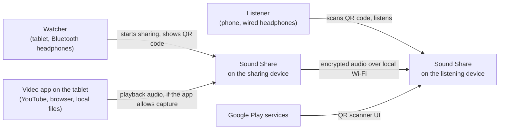

# C4 Model

## Context

No server is involved. Apps that forbid capture (Netflix) give Sound Share
silence.

## Container

One Android app with two roles, chosen per device in the UI.

| Container | Runs as | Responsibility |
|---|---|---|
| UI | `MainActivity` with Compose screens `SharePanel` and `ListenPanel` | Permissions, capture consent, QR display and scanning, pairing, delay slider, status |
| Capture service | Foreground service `sender/CaptureService` (type mediaProjection) | Captures playback audio, hands 5 ms packets to the stream server |
| Playback service | Foreground service `receiver/PlaybackService` (type mediaPlayback) | Runs the stream client, jitter buffer and loss concealer, writes to `AudioTrack` |
| Shared state | `ShareState` (in-process flows) | Lets the services report status to the UI |
| Storage | `PairingStore` and the settings file (private shared preferences) | Own pairing code, codes of paired devices, delay, last typed address |

## Component

`core/` is plain Kotlin with no Android dependencies, so it is unit tested on
the JVM.

| Component | File | Role |
|---|---|---|
| Wire format | `core/Protocol.kt` | Packet layouts, nonces, sealing and opening every packet type |
| Packet crypto | `core/PacketCrypto.kt` | AES-GCM for one packet |
| Pairing | `core/Pairing.kt` | Pairing code, key id, session keys, QR payload |
| Stream server | `core/StreamServer.kt` | Sender: beacons, probes, authenticated listener list, sends audio |
| Stream client | `core/StreamClient.kt` | Listener: probe, hello, decrypt audio, follow session changes |
| Discovery | `core/BeaconListener.kt` | Lists sharing devices on the network |
| Jitter buffer | `core/JitterBuffer.kt` | Holds audio for the chosen delay; corrects clock drift |
| Loss concealer | `core/LossConcealer.kt` | Fades around missing packets |

All paths above are under `app/src/main/java/io/github/strawberryfrappe/soundshare/`.

## Code

The packet-level design is documented in the header comment of
`core/Protocol.kt`; it is the reference for the wire format.
